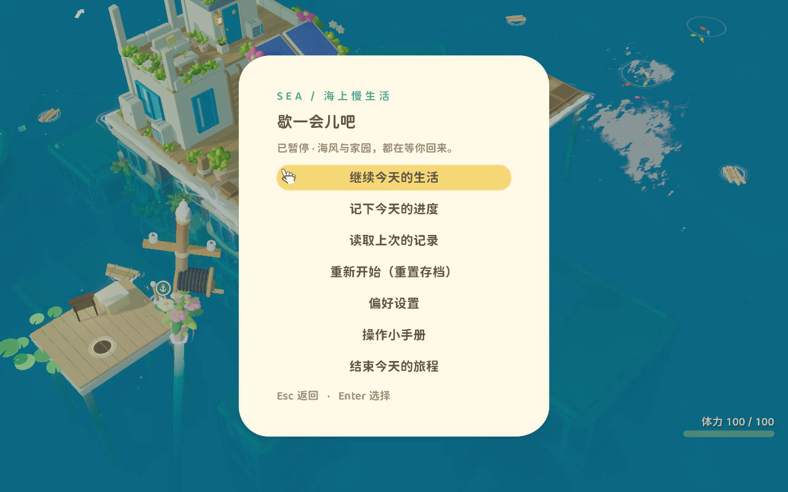
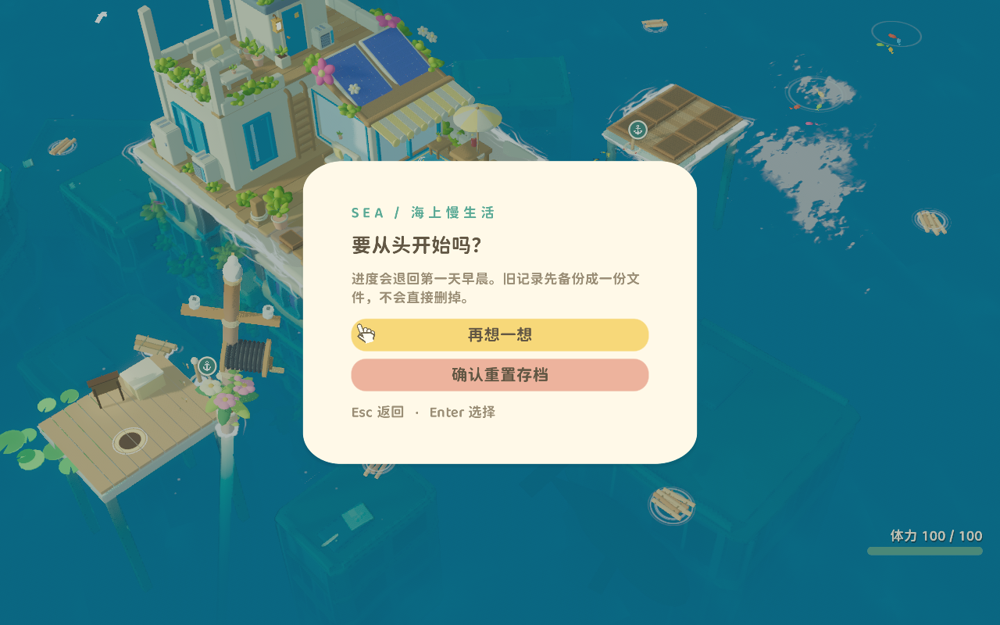

# 2026-11-02 · 重置存档（SEA-SAVE-R14）

需求：「增加一个重置存档的功能」。

这个项目的存档是核心资产，所以做法不是「删掉存档文件」。**重置 = 归档 + 回开局 + 立刻写新档**，旧进度改名留在磁盘上。

## 为什么不能删

玩家的存档里可能有几十小时的建造布局和作物。哪怕是他亲手按的确认，也不等于愿意永久烧桥。所以重置走 `rename` 而不是 `remove`：

```
user://save_slot_0.json                      ← 重置前的进度
user://save_slot_0.bak                       ← 上一次写盘的备份
        ↓ 重置
user://save_slot_0_pre_reset-2026-11-02-140233.json
user://save_slot_0_pre_reset-2026-11-02-140233.bak.json
user://save_slot_0.json                      ← 新写的开局档
```

归档名带 `_pre_reset-<时间戳>` 前缀，**不是**盖掉 `.bak`：`.bak` 是「上一次写盘」的单份回滚点，会被下一次写盘顶掉。归档必须待在写盘循环之外，否则重置完随便存一次档，旧进度就真没了。

`.tmp` 不归档 —— 那是没写完的中间产物，没有保留价值，下次 `write` 会直接截断它。

## 三步，顺序不能换

```gdscript
func reset_save(path := "") -> Dictionary:
	if dive != null and dive.active: ...            # 潜水时拒绝
	if save_registry.is_busy(): ...                 # 结算/过场时拒绝
	var archived := SaveGameLib.archive(target)     # ① 归档
	if not archived.get("ok", false): return archived
	var fresh: Dictionary = save_registry.defaults()  # ② 回开局
	var res: Dictionary = save_registry.restore(fresh)
	if not res.get("ok", false):
		_unarchive(target, archived)                  # 回开局失败 → 归档放回去
		return res
	_save_protected = false                            # ③ 撤保护 + 写新档
	_autosave_on = true
	var wrote := save_game(target, true)
```

**① 必须最先做。** 先回开局再归档，中间出错就是一个「档没了、内存也半新的」现场。

**② 用 `save_registry.defaults()`，不用重载场景。** `defaults()` 是装配时每个所有者 `register(...)` 时交上来的开局快照，和读档走同一个 `restore()`：先校验全部模块、再改任何模块，中间事件被屏蔽，最后发一次 `restored`。所以 HUD、相机、昼夜、海面浮标都按原来的接线自动跟上，没有第二套「回到开局」的实现。

重载场景这个做法看起来更干净，但它是错的：`Economy` 和 `GameState` 是 Autoload，重载主场景不会重建它们，背包还是旧的 —— 而且 `snapshot_registry` 会在 `_exit_tree` 里被 `clear()`。那不是重置，那是一场事故。

**③ 立刻写新档，不能省。** 不写的话玩家重置完直接退出，下次启动 `load_game()` 又把旧进度读回来，观感就是「重置没生效」。这一步还顺手撤掉两样东西：

- `_save_protected`：之前读档失败会立这个旗子挡住写盘，不撤掉新档根本写不进去；
- `_autosave_on`：读档失败时被关掉的自动存档也要恢复，否则重置完玩一小时也不会自动存。

## 两个容易漏的边界

**归档失败要整体回滚。** 主档挪走、备份挪失败 —— 这时如果照常继续，槽位上「主档没了、备份还在」，下次启动会自动从 `.bak` 恢复，玩家看到的是「我重置了，怎么旧进度又回来了」。所以失败时把已经挪走的文件逐个改回原名，然后取消整件事。

**水壶要补满。** `_after_restore` 只在人在岸上时补水壶。重置后可能还在船上，不补的话第一天就带着一个空水壶开局 —— 开局状态本来就该是满的。

## 界面

入口放在暂停菜单，紧接在「读取上次的记录」下面；破坏性动作单开一页，**默认焦点在「再想一想」**（Enter 连按不会把档重置掉）：

| 页 | 标题 | 按钮 |
|---|---|---|
| pause | 歇一会儿吧 | 继续 / 记下今天的进度 / 读取上次的记录 / **重新开始（重置存档）** / 偏好设置 / 操作小手册 / 结束今天的旅程 |
| reset | 要从头开始吗？ | **再想一想**（默认聚焦） / 确认重置存档 |

确认页副标题直说「旧记录先备份成一份文件，不会直接删掉」—— 玩家敢按的前提是知道丢了还能捞回来。

命令走既有的 `command_requested` 路由（`"reset"` → `_on_click_command`），复用它已经在做的「关掉相机/调色面板、取消当前动作、检查 `Scope.command_enabled`」。




## 验证

`save-reset`（27 项 0 失败），在正式主场景上跑。关键在于**三条同时量**：

| 断言 | 为什么要有这一条 |
|---|---|
| 内存回开局：瓶盖 80 / 种子 3 / 材料 0 / 第 1 天 / 07:00 / 晴 | 只测这条的话，「删档 + 重开」也能全绿 |
| 磁盘上的新档是开局状态（重新 `read()` 读回来，不信内存） | 内存对了、文件还是旧的，是最容易出错的地方 |
| **归档里就是旧进度**（瓶盖 600 / 木板 30） | 这条才是「不烧桥」的证据 |
| 主档与备份**都**归档（先存两次造出 `.bak`） | 只挪主档会留下 `.bak`，下次启动莫名回退 |
| 归档名带 `_pre_reset`、仍是 `.json`、不在原槽位路径 | 能直接双击打开，且不占 `.bak` 回滚位 |
| `_save_protected` 已撤掉 | 不撤的话新档写不进去，测试会假绿（因为旧文件还在） |
| 连按两次重置：第一份归档不被覆盖 | 归档名用时间戳，不确认一下怎么知道没撞名 |
| 空槽位重置：成功且清单为空 | 「没有存档」不是错误 |
| 读档保护立着时也能重置 | 真实路径：读档失败 → 玩家想重开 |

`visual-save-reset`（5 项）抓两屏并断言：入口存在、确认页真的切过去、有确认与取消、**开头那个按钮不是重置**。

回归：`save-protection`、`save-seed`、`framework-integration`、`minimum-loop` 本轮均 PASS。

`selftest` 是 **511 passed / 26 failed**，与本条无关：失败项集中在种植前置、采集点位置、zone4/zone5 区域数量与船位复原，都是本轮之前工作区里已存在的改动（`building_*`、`ocean_population` 等文件在 10:41–10:46 就被改过，早于本次 13:51 开工）。本条只加了 `reset_save()` / `SaveGame.archive()` 与一个菜单页，不碰种植、采集、区块。如实记录，不以历史结果代替当前实测。

`check_feature_contracts.py` 本轮报 **13 项 runtime hash drift，全部是另一个并行会话正在做的渔业资产 `.import`**（`godot/assets/models/fishery/*` 与一张共享贴图）。这些不在本条范围内，也不去批量更新它们的哈希 —— 按工程约定，未知变更不能靠刷哈希藏掉。本条自己改的 `main.gd` 哈希已同步，不在失败列表里。

| 命令 | 说明 |
|---|---|
| `python3 scripts/run_verification.py save-reset` | 行为 27 项 |
| `python3 scripts/run_verification.py visual-save-reset` | 两屏渲染 5 项 |

Windows 上跑 runner 建议带 `PYTHONUTF8=1`：`project.godot` 里有中文（`sea · Godot 版`），默认 GBK 解码会直接崩，报 `UnicodeDecodeError`。

本轮观测：[2026-11-02_save_reset_verification.json](2026-11-02_save_reset_verification.json)（隔离用户目录，不触及玩家槽位）。

## 边界

- **存档格式没变**：重置产出的就是一份普通 v4 开局档，版本号、迁移链、校验规则全不动。
- **不删任何文件**：整个功能里没有 `remove`，只有 `rename`。
- 归档不会自动清理。这是刻意的：清理归档等于换一种方式删档，要不要做、做多久，得单独定。
