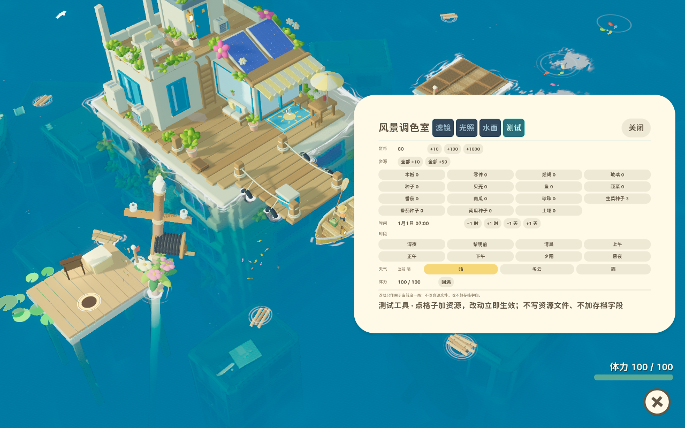

# 2026-11-02 · P 面板第四页「测试」，归类为 SEA-TOOL

需求原话：「游戏中按 P 键里头，增加一个页面，小一点，然后点进去后可以增加各种货币和资源的，还可以调整时间，天气等等。完成后更新设计文档，这个归类到测试工具里头。不要影响游戏本身逻辑结构。」

## 做法

P 面板从三页变四页：**滤镜 / 光照 / 水面 / 测试**。前三页一字未动（含分时段偏移、收藏、写回资源文件那套），第四页是验证入口。

**页面代码独立成文件。** `godot/src/debug/test_tools_page.gd`，面板只负责挂载和转交端口：

```gdscript
func _build_test() -> void:
	_test_page = TestPageScript.new()
	_test_wrap.add_child(_test_page)
```

为什么分开：调色三页改的是「画面参数」，测试页改的是「游戏状态」。混进 `color_grade_panel.gd`（已经 2900 行），「这个面板只管画面」这条职责就没了，以后再有人改水面参数，得先绕过一整页资源按钮。

## 不影响游戏逻辑结构，靠三件事

1. **不新增状态、不新增存档字段。** 页面显示的一切都从既有所有者实时读：`Inventory` 的数量、`WorldClock.query()` 的时间、`WeatherService.kind`、`EnergyModel.current`。
2. **所有写入走既有公开接口。** 加物品 → `Economy.give`（容量、堆叠、溢出提示照旧）；换天气 → `WeatherService.set_weather`（非法 id 由服务拒绝）；回体力 → `EnergyModel.refill()`；改时间 → `WorldClock` 已有的 `day` / `seconds` 两个公开字段，然后广播它自己声明的 `changed` / `day_changed`。`world_clock.gd`、`weather_service.gd`、`economy.gd` **一行没改**。
3. **能力靠端口注入，页面不认识 Economy / Main / HUD。**

```gdscript
	grade.set_test_ports({
		"catalog": Callable(self, "_debug_catalog"),
		"count": func(id: String) -> int: return Economy.count(id),
		"give": func(amounts: Dictionary) -> void: Economy.give(amounts),
		"clock": func() -> Dictionary: return world_clock.query(),
		"set_time": Callable(self, "_debug_set_clock"),
		"weather": func() -> String: return weather_service.kind,
		"set_weather": func(kind: String) -> bool: return weather_service.set_weather(kind),
		"energy": func() -> Dictionary: return {"current": Economy.energy.current, "maximum": Economy.energy.maximum},
		"refill_energy": func() -> void: Economy.energy.refill(),
	})
```

缺哪一项，那一组按钮就禁用、页面写「未接线」—— 所以这个面板在没有主场景的验证工程里照样能实例化（`check_light_params.gd` 就在那样用它）。

时间写入口只有一处，`Main._debug_set_clock(day, seconds)`：

```gdscript
	var next_day := maxi(1, day)
	var next_seconds := fposmod(seconds, 86400.0)
	var jumped: bool = next_day != int(world_clock.day)
	world_clock.day = next_day
	world_clock.seconds = next_seconds
	if jumped:
		world_clock.day_changed.emit(next_day)
	world_clock.changed.emit(world_clock.query())
```

`maxi(1, ...)` 不是随手夹一下：存档契约里 `day >= 1`，测试工具往回跨午夜时也得守住这条，不能给玩家造出一份非法档。

## 页面长什么样

一行一组，全部紧凑药丸（24 px 高、11 px 字），不占满屏：

| 组 | 控件 |
|---|---|
| 货币 | 瓶盖 +10 / +100 / +1000 |
| 资源 | 物品表格子（左键 +10、右键 +100）+「全部 +10」「全部 +50」 |
| 时间 | 当前 `1月1日 07:00` + −1 时 / +1 时 / −1 天 / +1 天 |
| 时段 | 深夜 / 黎明前 / 清晨 / 上午 / 正午 / 下午 / 夕阳 / 黑夜（跳到该段首帧，日期不动） |
| 天气 | 晴 / 多云 / 雨（当前那一种高亮） |
| 体力 | `x / 100` + 回满 |

资源格子是**从 `assets/data/items.json` 派生**的，不写死清单：表里加了新物品，这一页下次打开就有。货币在表里 `stack = 0`（不占背包格），所以单列一行，不混进材料格子。

页面打了 `island_label` 标记，让 `Cozy.style_tree` 整棵跳过 —— 不跳的话每个按钮会被顶到 44 px 高、字号 18，五组控件能把面板撑出屏幕。

## 两处必须处理的「面板自身的副作用」

**一、昼夜预览。** 调色三页打开时会 `DaylightRig.set_preview()`，把画面钉在选中的时间段上。测试页要改的是真实时刻，锁着预览就会出现「状态变了、画面不动」，看起来像工具坏了。所以切到测试页时放开（`clear_preview`），切回调色页重新锁上，关面板同样放开。抽成一个函数：

```gdscript
func _sync_preview_hold() -> void:
	_preview_held = visible and _tab != TAB_TEST
	if _preview_held:
		_hold_preview()
		return
	var rig = _daylight()
	if rig != null:
		rig.clear_preview()
```

**二、左侧侧栏。** 那十五条「季节 / 天气 / 时间段」按钮标的是「面板预览用哪一段」，而测试页改的是真实天气与真实时刻。两套并排出现，按下去哪一个才是真的分不清 —— 所以测试页不显示侧栏。

## 验证

新专项 `test-tools`（`godot/tests/test_test_tools.gd`），在正式主场景上跑，走「用户点按钮」的同一条函数：

| 断言 | 结果 |
|---|---|
| 默认仍停在滤镜页 | PASS |
| 「测试」页可切换并显示 | PASS |
| 木板 +10 / 瓶盖 +100 落到 Inventory | PASS |
| 「全部 +10」覆盖到不在第一排的物品、与单项加的是同一本账 | PASS |
| 资源格子按物品表生成（含 wood） | PASS |
| +3 小时 → 10:00；跳 17:00 不改日期；+1 天保留时刻；−1 天退回 | PASS |
| 23:30 +1 小时 → 次日 00:30；`day >= 1` | PASS |
| 雨 / 多云生效，`query().rain == 1.0`；非法天气被拒且状态不变 | PASS |
| 体力 3 → 满 | PASS |
| 测试页 `is_previewing() == false`；切回光照页重新锁定；关面板放开 | PASS |

会话实跑日志：[2026-11-02_test_tools_panel.json](2026-11-02_test_tools_panel.json)（`python3 scripts/run_verification.py test-tools`，23 checks / 0 failures，隔离用户目录）。

## 真实渲染核对

两档分辨率各抓一张（`--capture --test`，独立用户目录、不写玩家槽位）：




这一轮抓到并改掉两处版面问题，都是只有真渲染才看得见的：

1. **时段那一行溢出纸边。** 八个按钮排一行，最后一格「黑夜」被面板右缘截掉。改成 4 列两行 —— 700 px 面板里一行八格每格只剩 68 px，「黎明前」三个字都放不下。
2. **天气当前值被挤出边框。** 原来是行尾右对齐的标签，前面三个 `SIZE_EXPAND_FILL` 按钮把它顶到了纸外。改成放在按钮**前面**的固定 56 px 小字，位置稳定。

两档都确认：面板整块在屏幕内、无行被截断、物品名与数量可读、左侧侧栏在测试页确实不出现。


## 边界

- 这一页不进发布玩法口径：`play_scope.gd` 未改，`SEA-UI-R19` 的最小范围限制不变。
- 测试工具不进存档：改的是当前这一局的运行状态，关掉游戏照常按原样存盘。要还原就重开一局。
- 时段那两行文字是「跳到该段首帧」，不是「把时间锁在那一段」：点完时间照常往前走。
