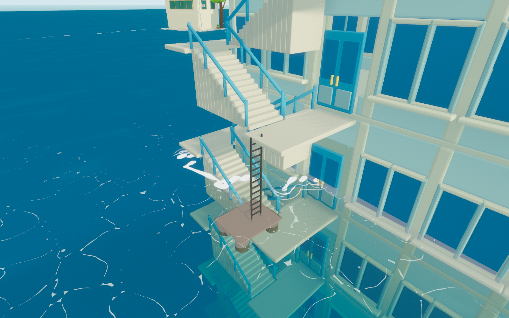
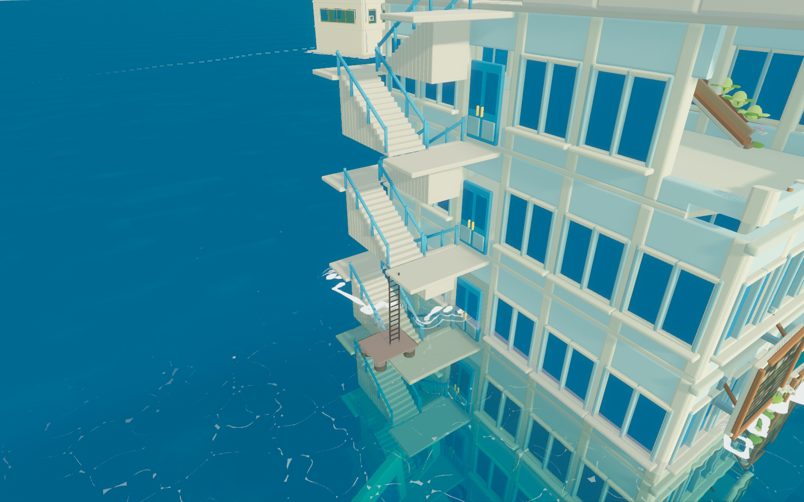

# 2026-11-10 霓虹花园左楼屋顶上下通路

起因是第一轮设施体检留在「未做」里的那一条：霓虹花园的泊位落在水面 `y = 1.12`，站立点却在左楼屋顶 `y = 15.20`，垂直差 **14.08 m**（`SEA-WORLD-R32`）。玩家从船上「上岸」等于一次瞬移，落差十几米，看着像凭空出现在楼顶；反过来站到屋顶边沿，也没有任何路能下去。

本轮把它补成一条真的走得到的路。

## 一、先量清楚：楼里本来就有一架梯子

霓虹花园左楼模块（`modules/left_building.tscn`）东侧本来就有 24 个楼梯构件：`stair_flight_256..278`（12 段梯段）+ `stair_landing_257..279`（12 块平台），从楼基一直砌到局部 `y = 30.60`。它们从来只是装饰——没有任何 `WalkArea` 派生它们，所以「看得见、走不上」。

量尺寸踩的第一个坑：**主场景把这栋楼转了约 72° 并摆在 `y = -15.87`**（`quarter.global_transform.basis.x = (-0.3058, 0.9521)`，原点 `(106.56, -15.87, 88.88)`）。直接用子节点的世界 AABB 量，一个 3.55 m 的梯段会量成 4.8 m，`rise` 甚至出现 `+986.98`。`probe_stair_chain.gd` 改成**以 `LeftBuilding` 为坐标系、对 8 个角点逐个逆变换**重算，才拿到真值：

| 项 | 实测（楼体局部） |
|---|---|
| 梯段数 | 12 段双跑折返，每段升 2.55 m |
| 平台 | 远侧 `z = -8.90 .. -6.90`、近侧 `z = -2.98 .. -0.98` 之间折返 |
| 总高 | 局部 `y = 0 → 30.60` |

## 二、屋顶走域一直是好的，缺的只是「上去」

第二个坑更绕。要确认屋顶走域下面真有屋面，先走过三条错路：

1. 用 `roof.surface_point()` 扫局部格子 —— 只命中 14/728 格（2%），误以为屋顶只有一条窄带；
2. 改用物理射线 —— 全部打在**走域自己生成的 `GroundFloor`** 上，循环论证；
3. 排除 `256|512` 碰撞掩码后再打 —— 全部「无实体」，因为**这些建筑根本没有碰撞体**。

最终改吃楼体自身的 313276 个三角形做重心插值判定：14 条屋顶 rect **全部压在真实屋面上**（楼体支撑 `15.23` vs `surface_y 15.20`，差 `-0.03`）。结论是屋顶本身没问题，断的是「水面 → 屋顶」这一段。

## 三、通路怎么接

```
水面 1.12  ──直梯 3.71 m──▶ 平台 4.83 ──4 段折返──▶ 梯顶 15.03 ──0.20 m 台阶──▶ 屋面 15.23
   │                          ▲
   └─ 浮台(2.2×1.8) ──────────┘  这一段必须靠梯子，中间没有可走面
```

| 段 | 做法 |
|---|---|
| 水面 → 平台 4.83 | `stair_foot.tscn` 浮台（甲板 1 + 3 根横梁 + 4 个浮筒 + 直梯 15 件＝两侧立杆 + 13 级踏板，共 23 个网格），甲板上表面正好 `1.12`。竖直 3.71 m 走 `SiteLadderInteractable` ×2 + `ActorController.climb_ladder` |
| 平台 4.83 → 梯顶 15.03 | `WalkLeftStair`：`surface_y = 15.03`、`span 4.6 .. 15.2`、`body_radius > 0`（交共享 Recast 烘焙），几何用 **22 个三角形**：5 块平台 + 4 段斜坡梯段 + 2 段补桥（一段 0.39 m 抬升，一段与屋面共面，一直铺到楼体局部 `x = -1.19` 对齐屋顶最西那条 rect） |
| 梯顶 → 屋面 | 0.20 m 台阶，在 `agent_max_climb = 0.30` 以内，直接走上去 |
| 浮台走域 | `WalkLeftFloat`：`surface_y = 1.12`、`rects = [Rect2(-8.4, -3.4, 2.2, 1.8)]`、`body_radius = 0`（精确网格） |

三件套都挂在 `neon_garden_quarter.tscn` 的 `WalkAreas` 下，`position` 与 `LeftBuilding` 一致（`-15.813, 0.30, 0.618`），否则斜放楼体上会整体漂移。

## 四、四个坑

### 1. 梯段端点接反：不报错，只是烘成 8 张孤岛

生成器首版的 A/B 两道把 z 端的起止写反了，四个梯段全部**悬在两侧平台之间**（低端对着平台外沿之外）。Recast 不会报错——它把整段梯子烘成完全独立的岛，`navigation_polygons` 停在 `382`。

此时每一格采样「最近多边形偏移 0.02–0.06 m」，看上去一切正常；但 `route()` 从屋顶到任何一级平台都返回 **0 点**。修正两处 `quad(...)` 的 z 参数顺序后，`navigation_polygons` 到了 **463**，逐级求路全通：

```
[route] 登岸点 (110.65, 15.20, 72.87)  ground_space=true  polygons=463
[route] L279 30.60  面 y=15.03  屋顶路径  9 点  上一格→本格  9 点
[route] F278 29.33  面 y=13.76  屋顶路径 22 点  上一格→本格 13 点
...
[route] L271 20.40  面 y= 4.83  屋顶路径 73 点  上一格→本格 12 点
```

**教训**：`map_get_closest_point` 偏移小**不能**证明连通。验收必须逐级求路（屋顶 → 每一级平台），只看两端会漏掉中段断开。已固化为 `SEA-NAV-R24`。

### 2. 交互点的 XZ 就是攀爬竖线

`climb_ladder(start, end, subject)` 只吃 Y，人沿**自己脚下那条竖线**升降，XZ 由交互点决定。首版把交互点放在楼体局部 `x = -6.905`，离平台外沿（`x = -7.09`）只有 **0.185 m**，比角色半径 0.38 m 还窄——踩上去半只脚悬在外沿外，爬到 4.83 m 顶就掉回水里。

收到 `-6.705`（距外沿 0.385 m，刚好超过角色半径）后落稳。同时在 `SiteLadderInteractable.interact()` 里加了一个「伸手抓梯」的小横向纠偏：仅当船体/角色距交互点 `focus_radius + 0.4` 以内才把 XZ 贴到梯子线上，保证造型与竖线不完全重合时也不会踩空。已固化为 `SEA-NAV-R23` 中「攀爬竖线必须同时落在两端落脚面以内」一条。

### 3. 一根竖梯必须两个交互点

`Interactor.candidates()` 会滤掉竖直偏移超过 2.5 m 的目标。这架梯子 3.71 m，**一个点必然有一头够不着**，所以上下各放一个（`StairFootBottom` / `StairFootTop`，梯顶那个 `direction = "down"`）。

### 4. 浮台不能挡船

浮台是手摆造型，标了 `metadata/visual_only = true`，`BlockerSet._scan()` 尊重这个标记，所以不参与水面阻挡派生。测试里专门锁了「浮台所在水面不挡船」——否则船停不进来，人会困在浮台上。

## 五、实现清单

| 文件 | 作用 |
|---|---|
| `godot/tools/build_neon_stair_walk.py` | 生成器。用 `MARK_BEGIN/END` + `VISUAL_BEGIN/END` 区块幂等写入 `neon_garden_quarter.tscn`，自动补 `ext_resource` |
| `godot/scenes/facilities/neon_garden_quarter.tscn` | 新增 `WalkLeftStair`、`WalkLeftFloat`、`Visual/StairFoot`、`Ladders/StairFootBottom`、`Ladders/StairFootTop` |
| `godot/scenes/components/facilities/neon_garden_quarter/stair_foot.tscn` | 浮台造型（`SEA-SCENE-NGQ-054 v001`） |
| `godot/src/interaction/site_ladder_interactable.gd` | `SiteLadderInteractable`：`direction` / `climb` 回调 / 上下端 y / 抓梯纠偏 |
| `godot/src/bootstrap/main.gd` | `_setup_ladders()`：把 `climb_ladder` 接到两个交互点 |
| `godot/tests/test_neon_roof_access.gd` | 41 项断言 |
| `scripts/run_verification.py` | 注册 `neon-roof-access` |

## 六、验证

`neon-roof-access` **41 checks / 0 failures**（`exit 0`），锁六组：

1. 22 个三角形、不靠压平的矩形、`body_radius > 0`；
2. 走域底端 `4.83`、顶端 `15.23`；
3. 梯顶 → 屋面台阶 `0.20 m`（在 `-0.05 .. 0.30` 内）；
4. 屋顶 → 梯顶、屋顶 → 梯脚两条 `route()` 都通且终点偏移 < 1.0 m；
5. 浮台在水面 `1.12`、站得住、与平台之间**没有**可走面、所在水面不挡船；
6. 造型贴攀爬竖线 < 0.45 m、甲板上表面正好 `1.12`、梯子顶到 `4.83..5.10`、两个交互点 `can_interact()`。

证据批次：`D:\projects\sea-work\verification\20261110-202801-neon-roof-access-final-89f113`。注意该批次 `passed: false` —— 原因不是本用例，而是工作区里两处别人的未完成改动让 `main.gd` 编译失败（`src/ui/island_menu.gd:170` 无法推断 `handled` 类型、`src/workshop/host.gd` 的 `const Panel` 与原生类同名），连带刷出大量 `'active' on Nil`。用例本身 `exit 0 / 0 failures`，与 `dock-hotspot` 基线表现一致。

体检复跑（`python scripts/audit_facility_access.py neon-stair-access`，`D:\projects\sea-work\diag\20261110-203207-neon-stair-access`）前后对比：

| 项 | 前（`20261110-163315-step4`） | 后 |
|---|---|---|
| 霓虹街区走域 | 227.88 m² | **267.57 m²**（+39.69） |
| 新增走域 | — | `neon_garden_left_stair` 35.73 m²（单岛、0 flags）、`neon_garden_left_float` 3.96 m² |
| 霓虹街区阻挡 | `block_area_m2 25.12` / `hole_pct 24.71` | **完全一致**（浮台没进阻挡派生） |

`neon_garden_left_float` 报 `surface_at_or_below_water` + `walk_over_water` 两条 flag：浮台本来就是浮在水面上的甲板，面高等于水高，这两条是必然结果，不是缺陷。`visual-blockers` 复跑 zone3（霓虹街区）`rects=40 空=0 漏=0.5%`，与本轮前一致；该用例整体仍因 zone4 的旧问题判 FAIL（zone4 已从主场景移除，`SEA-WORLD-R08`，与本轮无关）。

## 七、未做

- **后楼顶（10.10）与右楼顶（20.30）仍无通路**：这一轮只接了左楼顶（也就是泊位所在的那一个）。另外两个楼顶依旧只有「可站、可放 NPC」的意义，不得据此假定玩家能走上去。
- **原街口 `WalkStreetLanding` 仍 `active = false`**：第一轮已关闭（铺地在世界 −14.45，水下 15.6 m），本轮不动。
- **未做升降机**：14.08 m 用折返梯 + 直梯解决，没有引入新机制。

## 八、证据

浮台与直梯（`neon_stair_foot.png`）：甲板贴着水面、四只浮筒半沉，直梯从甲板直上 4.83 m 的平台边沿。



整条折返梯（`neon_stair_wide.png`）：直梯 → 平台 → 两段可见的折返梯段继续向上，构件与原有楼梯装饰完全对齐。



- 逐级求路：`godot/tools/probe_neon_stair_route.gd`
- 楼梯度量：`godot/tools/probe_stair_chain.gd`
- 屋面支撑：`godot/tools/probe_neon_roof.gd`
- 局部↔世界换算与泊位三件套：`godot/tools/probe_frame.gd`
- 用例：`godot/tests/test_neon_roof_access.gd`
