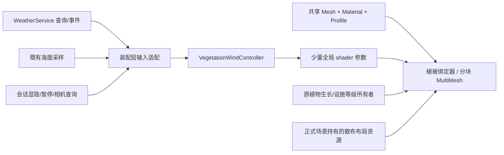

# 植物、草地与青苔视效方案 · v1

[主文档中控](../../../GDD_V1.0.md#sea-ambient) · [功能规格](spec.md) · [实施账本](ledger.md) · [制作规范](../../standards/植被视效制作规范.md)

日期：2026-11-05。目标平台：**用户已确认桌面 PC 优先**。本版为技术选型与制作设计，不表示运行系统、插件接入或性能验收已完成。后续实施状态只在功能账本维护。

## 1. 选型结论

采用 **共享 GPU 风场 + 有权重的风格化几何 + 分块 MultiMesh + 草苔分层覆盖 + 按屏幕大小分级**。在现有 SEA-AMBIENT 内推进，避免另建一个重复拥有植物生命周期的功能。

- 叶簇、花卉和蒲草：保留宽厚、圆润、低频细节的外形，以根部固定、枝叶错相摆动形成柔软感。
- 草地：薄而有厚度变化的覆盖基底，叠加疏密变化的低面分段草簇；近处有草尖，远处保留完整绿色覆盖。
- 青苔：静止的圆润苔垫与边缘短绒簇组合。风只轻拂短绒和细小叶尖，不让贴墙苔垫像果冻一样整体起伏。
- 荷叶等水面植物：风动与浮动分开；浮动只消费现有海面高度/法线输入，不再制作第二套海浪。
- **ProtonScatter 作为可选的编辑器散布工具采用，正式运行采用项目自有烘焙数据与渲染器。** 插件不承担风、柔软材质、性能承诺或玩法状态。正式接入前需完成小样验证与输出适配。

首轮不采用全场壳层草/壳层毛发、逐草骨骼、逐草物理、全屏交互纹理和自研 GPU 间接绘制管线。它们增加叠层填充、维护成本或平台差异，目前屋顶、墙缝与岸边的小片植被没有证据需要这些成本。

## 2. 视频参考：哪些值得迁移

参考为用户本地视频 `C:/Users/zhuangmenghong/Desktop/cdcdae86e4001b75d34fb4f58373ef7f.mp4`，14.666667 秒、720×1080、30 FPS。SHA-256：`b586549578ed79117367dc27e97b38c22c1a0e49546c614324369bbc946750e6`。已观察约每 2 秒抽帧、4 秒原尺寸画面，以及 3–5 秒每 0.25 秒水边植物序列；这属于抽帧视觉分析，不是对源工程的识别。

| 观察到的画面特点 | sea 的采用方式 | 推断边界 |
|---|---|---|
| 屋顶绿植呈连续、圆润的块面，轮廓有细小叶缘和稀疏花点 | 保留公共色板；通过苔垫/叶簇体积、少量边缘细节形成柔软感 | 视频不能证明用了毛发或壳层技术 |
| 小花与宽叶分散在绿色主体中，不是密集写实针草 | 小花作为少量独立实例；默认镜头优先读出花色与叶形 | 不直接复制花朵纹理、模型和具体建筑 |
| 相邻帧中的水边宽叶/荷叶有轻微姿态与位置变化 | 低频弯曲、局部叶尖细动、与浪面相符的轻浮动 | 镜头也有变化，无法精确反推出振幅、频率或浮动算法 |
| 大块青苔/绿覆盖整体稳定，细节和水边更活跃 | 把“风吹过”集中在轮廓、短绒、叶尖及相干的风带 | 视频里草尖很小；不能据此声称已测得草地风场 |
| 绿色与蓝色水面、暖色建筑分层明显 | 在 sea 原有奶油、暖木、植物绿上做小范围校色；全时段检查 | 不直接替换为参考片的整套强饱和光照 |

用户提出的“草地和青苔柔软、有风吹过”是明确的增强目标；即便视频中个别细节看不清，也应通过下述样板验证实现。视频只作为审美参考，来源权属未知，记录为 reference-only / pending；不把视频或截帧混入发行资产。

## 3. 项目现状与实际约束

以下为 2026-11-05 读取当前工作区的静态事实，非当前帧率或全场实例统计。

| 入口 | 实际情况 | 对方案的影响 |
|---|---|---|
| `godot/project.godot` | 标记 Godot 4.7 / Forward Plus；1600×1000；`msaa_3d=2`；方向阴影图 8192 | PC Forward+ 为主；采样数按引擎枚举核对，不能把配置值 2 直接称为 2×。不顺带提高全局阴影成本 |
| `godot/src/camera/orbit_camera.gd` | 默认距离 38 m、FOV 31°；允许 9–38 m 缩放（2026-11-05 上限由 190 收紧到 38），场景可覆盖 | 不照搬第一人称“20 m 后全删草”的距离表；以实际投影像素与取景验收 |
| `godot/src/ambient/plant.gd` | 每株 `_process` 计算正弦并直接写根 `rotation.x/z`；生长由 scale/Tween 驱动 | 迁移后关闭该株旧旋转，避免双重动画和覆盖作者倾斜；生长接口继续保留 |
| `plant_field.gd` / 植物摆放 JSON | 旧表共 161 条摆放，42 个植物 TSCN；其中农场表 149 条 | 是静态目录统计，不等于最小生活循环当前同时可见数；先按消费者确定迁移范围 |
| `sunny_bloom_visual.gd` | flora 逐株建 Component，并按单实例集合创建 MultiMesh；材质按角色强制选择 | 名为 MultiMesh 不代表已批量合并；须适配材料选择与分组，单换包装材质可能被覆盖 |
| 阳光房 `foliage.glb` | 1 网格/1 surface，5,280 三角面，只有 POSITION/NORMAL/TEXCOORD_0 | 造型可复用，需补权重并制作 LOD；不作为每平方米密铺的草簇 |
| 农场 `grass.glb` | 1 网格/1 surface，325 三角面，同样没有 COLOR/UV2；局部高约 0.20 m | 可保留为覆盖基底，先检查是否有足够可弯的纵向分段，再决定重制草尖 |
| 农场 `moss_cluster.glb` | 75 三角面；原始 POSITION 包络 Z 最小/最大均为 0，是平面网格 | 可留作远景/墙面覆盖；近景柔软体积需要新增苔垫和绒簇 |
| `weather_service.gd` / `weather.json` | 公开 query 没有风向/风速，当前固定晴天 | 不宣称已有全局风服务；本功能维护纯表现风，未来经适配器消费天气风 |
| `water.gdshader`、`water_absorption.gdshader` | 两套海面表现，吸收水面读取屏幕色与深度 | 水下叶片优先不透明，透明草可能不在水面取样中；两种水面都要测 |
| 资产与空间 | 现有植物记录部分继承 `above_water`；水下观赏全子树不得新增空间职责 | 不为散布便利给正式水下楼加碰撞；不批量“纠正”既有分类 |
| `material_param_guard.gd` | 项目已有 ShaderMaterial 序列化参数守卫 | 新共享材质需要纳入既有参数基线与编辑器重开检查 |

上述三份 GLB 的面数为原始 mesh primitive 之和，不含全场实例倍数，不冒充最终屏幕三角形预算。静态审计结果保存于工程外证据目录，见交付记录。

## 4. 方案比较与取舍

| 方法 | 风格/效果 | 性能与维护代价 | 决定 |
|---|---|---|---|
| 低面分段草簇 + 苔垫 + GPU 弯曲 | 轮廓清楚、受光柔和、风带可控，适合屋顶俯视 | 多用少量顶点，减少透明空白；便于公共色板复用 | **主方案** |
| Alpha Scissor 叶卡/草卡 | 适合细叶和远景枝叶，能丰富轮廓 | 空白区域仍有填充成本；缩远需防闪烁 | 有条件补充；水下优先实体叶形 |
| Alpha Blend 半透明草 | 可获得软边 | 排序、叠层填充及水面屏幕取样问题 | 不作为常规植被材料 |
| Shell/Fins 多层绒毛 | 近景厚绒感强 | 层数乘上绘制/覆盖成本，斜视边缘和海面组合需特殊处理 | 首版排除；只有苔垫样板确实不足再做局部对照 |
| 全场骨骼/物理草 | 可精确互动 | 大量节点、更新、碰撞与骨骼成本 | 只为将来的少数演出植物另立需求 |
| 大世界 Compute/间接绘制草 | 极大量实例有潜力 | 新管线、剔除、同步、调试及兼容维护成本高 | 当前无必要，不以“GPU”名称代替性能证据 |
| 仅滚动噪声/颜色 | 便宜的远景运动暗示 | 无轮廓弯曲，容易像光斑在滑 | 只作弱补充，不能验收为近景柔软草 |

Godot 官方说明 MultiMesh 以整块进行可见性判断，因此选小块批量绘制，不能把全图草装进一个 MultiMesh。[官方批量绘制说明](https://docs.godotengine.org/en/stable/tutorials/performance/using_multimesh.html)

Godot 对 Alpha Scissor 的定位包括植被，普通 Alpha Blend 有排序与阴影限制；我们进一步选择大部分草叶直接建形，以适配现有公共色板。[官方材质说明](https://docs.godotengine.org/en/stable/tutorials/3d/standard_material_3d.html)

## 5. 动态与柔软感的实现

### 5.1 三层运动，共用一个风源

1. **主摆**：同一世界坐标风带推动相邻植株，根部固定、越靠尖端越容易弯曲。
2. **叶片细动**：同一片叶的相位相同，相邻叶片略有错相；花茎随主摆，花头只带小幅滞后。
3. **阵风传播**：低频空间波随风向平移，让一阵风从一侧穿过草地。随机相位只加在细动中，不能把所有运动都随机到看不出风向。

基础表达为 `主弯曲 = 根尖权重² × 柔度 ×（常风 + 空间阵风）`，叠加低幅度叶尖运动，并限制最大弯曲量。草叶做分段曲线弯折/保长近似，避免只将上端水平拉长。枝叶大幅弯曲时法线也须随变形调整，否则会出现姿态在动而受光不动。

这种“整体弯曲 + 叶片细动 + 顶点数据”的分层思路有成熟实践；sea 采用自己的通道协议和柔和幅度，不复制原文章的写实配色、透明方案或代码。[GPU Gems 3：植被程序动画](https://developer.nvidia.com/gpugems/gpugems3/part-iii-rendering/chapter-16-vegetation-procedural-animation-and-shading-crysis)

初始调参区间（是样板起点，不是从视频测得的参数）：

| 预设 | 主运动 | 细节运动 | 约束 |
|---|---|---|---|
| 宽叶/叶簇 | 0.15–0.35 Hz，叶尖位移约植株高度 2–6% | 0.7–1.5 Hz，小幅叶缘弯曲 | 根与木质部固定，避免橡胶拉伸 |
| 低草 | 0.2–0.45 Hz，草尖位移约高度 5–15% | 0.8–1.8 Hz，幅度低于主摆的 1/3 | 草尖可见而不闪，根不滑动 |
| 蒲草/花茎 | 0.12–0.3 Hz，约高度 3–8% | 少量错相 | 花不转成风车 |
| 苔绒 | 0.2–0.4 Hz，绒尖位移约自身高度 2–6% | 极弱 | 苔垫固定，绝不按建筑高度放大 |
| 荷叶 | 风动低于陆生宽叶；浮动取现有波浪 | 极弱倾斜 | 不把风频率当波浪频率；叶面不频繁穿水 |

### 5.2 体积、光照与颜色

柔软首先来自轮廓和法线：叶片宽、端部圆；苔垫有不规则隆起；草簇的高度和方向略有差异。主体保持大块干净色彩，细节集中在边缘和近景，避免写实噪点盖满建筑。

材质沿用公共 PaletteUV，默认高粗糙度、低镜面；在受控范围内加根部压暗与叶尖提亮。草簇法线适度向上/簇体外侧混合，宽叶保留叶面朝向；背面法线正确处理，不能所有植物一律朝上。薄叶可用轻量背光近似，强度受真实光照驱动，夜间不得靠 EMISSION 常亮。第一版不依赖屏幕空间 SSS，不为植物整体更换全局后处理。

### 5.3 草地与青苔

- 覆盖面负责连贯色块与接触，草簇负责近景轮廓和摆动。覆盖面贴合作者指定表面，处理穿插与 z-fighting。
- 草簇做 2–3 种轮廓，密度按成片、空隙与边缘衰减组织；不要均匀撒满所有屋面。修路、门洞、梯顶、种植格、泊位和操作对象周围留空。
- 苔藓基底可用低矮圆润网格；墙苔用独立贴合网格，默认不依赖 Forward+ Decal。短绒优先在台阶边、断口与可见轮廓，正面平坦处降低密度。
- 苔绒的毫米级偏移在默认远镜头可能不足一个像素。近景验收真实绒尖弯曲；默认镜头通过稀疏较高嫩叶及同风场的极弱成片法线明暗变化传达风经过，不能声称看不见的细绒已有明显动态。明暗变化不得像移动光斑，是否保留由样板录屏决定。
- 水下只保留能透过水面读出的体块和叶形；深水里不可辨的高频绒簇不继续堆密度。

## 6. 共享系统与所有权

规划代码集中于 `godot/src/ambient/vegetation/`；着色器放 `godot/shaders/vegetation/`，与项目已有目录一致。图中的新类/资源均为规划接口。

| 所有者 | 输入/职责 | 禁止拥有的内容 |
|---|---|---|
| VegetationWindController（SEA-AMBIENT） | `configure(profile)`、`set_weather_snapshot(snapshot)`、`set_active(active)`、`set_paused(paused)`、`set_quality(tier)`；唯一写入 `veg_*` 全局参数，提供 CPU 只读 snapshot | 不修改 WeatherService、海浪、经营时间、存档或 Farm |
| 原 PlantField / 场景附件 | 生长、升级显隐、稳定实例身份；给表现层发送变化 | 不再逐株更新风相位；不保留两套摆动 |
| VegetationBinding | 将已验收资产与 profile 绑定到真正的 MeshInstance / MultiMesh；复用材质 | 不修改全项目共享建筑材质来“带动”花草 |
| VegetationPatch | 场景拥有局部布局；分块/LOD/批次、创建释放、统计查询 | 不创建碰撞、导航、产出或随机存档状态 |
| Scatter 适配器（离线工具） | 输入已完成的散布结果，输出中立布局和来源版本/哈希 | 不成为运行时布局真值，不在运行期重投射 |

当前天气没有风字段：v1 根据已注入的天气类型选择**纯视觉**风预设，晴天也有微风；方向由 profile 配置。未来若 SEA-WEATHER 提供真实风查询，则替换适配输入，并删除重复方向决策。水面现有运动不由此反向接管。

统一视觉时间以秒推进，与一天快进、睡觉跳日解耦。暂停菜单冻结；标题实景可继续微动；潜水隐藏海面世界时停止海面植物 CPU 更新，回到海面平滑恢复。相位不存档。测试可注入固定 phase/seed 以复现。显式维护各周期相位和可重复纹理偏移的环绕，不能随意对时间取模制造跳帧。Godot 内置 `TIME` 不受暂停影响，故不把它直接当作本系统的暂停时钟。[Spatial shader 时间语义](https://docs.godotengine.org/en/stable/tutorials/shaders/shader_reference/spatial_shader.html)

全局风参数在 project settings 先声明，再编译 shader；更新走 `global_shader_parameter_set`，读侧保留 CPU 快照，避免每帧反读渲染服务器。[全局 shader 参数](https://docs.godotengine.org/en/stable/tutorials/shaders/shader_reference/shading_language.html#global-uniforms)

## 7. ProtonScatter 源码评估

已在线访问用户指定仓库，并在工程外只读克隆核对。2026-11-05 读取的 `main` HEAD 为 `7198cc00078ebde61307578137c3f35223c6e438`，提交日期 2026-09-27；`plugin.cfg` 标注版本 **4.2.0**，这是插件版本，不是引擎版本。仓库 `project.godot` 声明 Godot 4.7 / Forward Plus，与项目配置一致，但不等于已在 sea 实测兼容。

仓库说明 GitHub 是 Codeberg 镜像。插件代码 MIT；README 对 demo 纹理另有来源限制，因此不整体导入 demo 美术。[仓库与授权说明](https://github.com/HungryProton/scatter)

| 已核对能力/行为 | 适用性与接入决定 |
|---|---|
| Shape 区域、负区域、修改器堆栈、固定 seed | 适合屋顶草地、岸边、墙苔的编辑器布置；种子与规则一起版本化 |
| `Use Instancing`；`use_chunks=true`；默认块尺寸 15×15×15 m | 已有分块能力，不重复声称插件“完全没有剔除”；sea 初始选 6×6 m 水平块并按楼层隔离，实测调优 |
| ScatterItem 的 visibility range、阴影、可见层设置 | 可用于编辑预览；正式分级仍按项目相机与材质策略验收 |
| Project On Colliders 需要物理碰撞，忽略纯 MeshInstance | 在独立制作场景加临时投射代理。水下观赏建筑和纯植物不为此增加运行碰撞 |
| `keep_static_colliders=false` 默认关闭，但可创建 PhysicsServer RID | 适配器必须禁止并验收 RID/空间职责，不能只检查场景树无 CollisionShape |
| `force_rebuild_on_load=true`、`enable_updates_in_game=false` | “游戏内不更新”不等于“加载不重建”；不能直接以默认设置接正式大场景 |
| ProtonScatterCache 保存变换并向插件节点恢复 | 是插件缓存，不是完全摆脱插件的烘焙；正式中立输出适配需自行实现并验证 |
| `custom_script` 路径能启用实例 colors/custom data | 不能假设风参数已被自动填好；必须核对通道值，避免实例色乘坏顶点权重 |
| 合并输入网格/材质，有多 surface 与大于 8 材质的回退分支 | 只给纯视觉单材质植物；不把带脚本、碰撞、多角色材质的整栋建筑交给它 |

源码证据：[核心节点](https://github.com/HungryProton/scatter/blob/7198cc00078ebde61307578137c3f35223c6e438/addons/proton_scatter/src/scatter.gd)、[合并与实例辅助](https://github.com/HungryProton/scatter/blob/7198cc00078ebde61307578137c3f35223c6e438/addons/proton_scatter/src/common/scatter_util.gd)、[碰撞投射](https://github.com/HungryProton/scatter/blob/7198cc00078ebde61307578137c3f35223c6e438/addons/proton_scatter/src/modifiers/project_on_geometry.gd)、[缓存](https://github.com/HungryProton/scatter/blob/7198cc00078ebde61307578137c3f35223c6e438/addons/proton_scatter/src/cache/scatter_cache.gd)、[插件版本](https://github.com/HungryProton/scatter/blob/7198cc00078ebde61307578137c3f35223c6e438/addons/proton_scatter/plugin.cfg)。

接入方式：固定 commit 的插件只在制作环境启用 → 每个小区域独立 scatter → 排除区和投射通过 → 输出稳定 AssetID、局部 Transform、seed/phase、profile 的中立布局 → 项目工具按块打包 → 正式 TSCN 引用。中立输出冷启动时移除插件仍应可加载。插件升级必须在副本比较固定 seed 的布局，不能直接更新正式摆放。

若插件在目标版本不稳定，保留同一布局协议，改由手工布点或一次性离线采样器生成；风、材质和运行系统完全不重做。本轮没有安装插件到 `godot/addons`，也没有执行其代码。

## 8. 性能分级与预算

### 8.1 渲染策略

- 默认每个设施/楼层内约 6×6 m 分块；用 4、6、8、12 m 对照寻找收益。不能把不同楼层、水上与水下、不同生命周期合成一块。
- 批次键为 Mesh/LOD + 材质/profile + shadow policy + 空间块 + 生长/显隐组。MultiMesh 不是“全部植被永远一个 draw call”，surface、阴影 pass 和材质变体仍影响提交量。
- 每实例静态差异写 `INSTANCE_CUSTOM`，运行期不逐草上传 Transform。启用 custom data 要在分配 instance_count 前设置；独立 Mesh 用对应实例参数，不假设 MultiMesh 的参数逐元素通用。[MultiMesh API](https://docs.godotengine.org/en/stable/classes/class_multimesh.html)
- AABB 覆盖所有实例变换与最大风摆/浮动余量，防止叶尖出框就整片消失；不得靠无限扩大 AABB 绕过验收。
- 相机阈值以单草簇投影高度起步：≥12 px 近景，4–12 px 中景，<4 px 切到覆盖面/简化体块；花、荷叶、大灌木按自身尺寸单独定档。阈值带约 15% 滞回；CPU 每 0.2 秒分摊更新块档位，风仍按帧在 GPU 连续。
- 草密度低档使用固定随机排序后的前缀子集，保持降档后的分布均匀。不可按位置排序再截断，造成半块秃掉。
- 远景保留色块和重要轮廓，减少细动、草尖密度与投影；近草默认不投独立阴影，灌木/高叶在限定距离投影。长草和苔绒不全场开双面阴影。
- 优先滞回切换/草尖缩回基底；确需交叉过渡才使用稳定抖动并检查水面。Godot `visibility_range_fade_mode=Self` 是 alpha 淡化，会进入透明路径，不能以“平滑 LOD”为由默认打开。[官方可见距离与过渡说明](https://docs.godotengine.org/en/stable/tutorials/3d/visibility_ranges.html)

### 8.2 PC 初始性能目标

以下为**待实测的工程目标**。尚未指定最低显卡、未采集当前帧时，不能承诺所有 PC 60 FPS。P0 样板阶段记录实际 CPU/GPU/驱动/引擎版本，选出验收基准机；1600×1000 与 1920×1080 都测。

| 档位 | 可见草/苔小簇软上限 | 植被可见三角面目标上限 | 植被新增主颜色 pass 提交目标 | GPU 增量 p95 / CPU 增量 p95 | 品质策略 |
|---|---:|---:|---:|---|---|
| PC 标准（默认） | 8,000 | 350,000 | 80 | ≤2.0 ms / ≤0.3 ms | 双层风；近中景草，少量苔绒；灌木有限投影 |
| PC 高 | 16,000 | 700,000 | 120 | ≤3.0 ms / ≤0.5 ms | 增加近景密度/边缘细节，不增加主体摇摆幅度 |
| PC 低/兼容候选 | 3,000 | 120,000 | 40 | ≤1.0 ms / ≤0.2 ms | 一层主风、简化草、无草阴影，苔垫保留 |

数量、三角面与提交同时受限，先到者生效；它们是报警阈值而非填满指标。GPU 实测优先于面数。实例缓冲和网格/纹理显存也要采集；不把 VSync 限速的 FPS 相同解释为“没有成本”。整帧 60 FPS 的 16.67 ms 预算单独验收，既有海面/阴影/建筑耗时不计作植被优化成果。Compatibility 仅预留降级，不在本轮承诺 Web/移动验收；PC 主方案不依赖必须切换渲染后端的能力。[渲染器适用范围](https://docs.godotengine.org/en/stable/tutorials/rendering/renderers.html)

### 8.3 基准测量协议

同机位、分辨率、光照、水面方案、seed、固定镜头轨迹，预热 10 秒，采样 60 秒，至少 3 次。记录整帧 CPU/GPU p50/p95/p99、draw calls、可见三角形、显存、实例/材质数及加载时间。

A=原场景；B=接入新几何但风关闭；C=相同几何开启风；D=密度压力档。B−A 判断内容成本，C−B 判断动画成本，C−A 判断整套方案增量。若 GPU 时间不可采集，明确 GPU 指标 pending，不能用 CPU 时间冒充。测默认镜头、最近/最远、贴草斜视（填充压力）、草占画面一半、夜间灯光、连续移动/分块切换。用隔离 runner 管理进程及存档，必要时在其子进程附加 GPU profiler。

## 9. 迁移和制作顺序

| 阶段 | 具体交付 | 转入下一阶段的证据 |
|---|---|---|
| P0 样板与基线 | 工程外基线；仓库内专用小样场景：宽叶、花茎、草地、墙苔/地苔、蒲草、荷叶各一组；统一风的静/动 A/B | 同一机位 10–15 秒真实录屏；近/默认/远景；取得 CPU/GPU 基线与用户可评审画面 |
| P1 公共能力 | 风控制器、两种实例绑定包装、共享 shader include、配置资源、材质基线、Scatter 中立输出适配 | 根固定/通道/旋转缩放/暂停/卸载测试；插件移除冷启动；无逐草风脚本 |
| P2 首个正式区域 | 野外渔场的 turf/reeds + 一小片草苔；阳光房一组独立叶簇 | 美术、风、接触、泊位/道路与海面组合通过；原生实景性能通过 |
| P3 分批迁移 | 农场草/苔，霓虹花园，外围半沉林带，再按消费者迁移旧 PlantField 与四阶段作物 | 每批保留稳定路径/身份/原布局与回退清单，逐批验收；不运行旧整场景构建器 |
| P4 扩展（另计） | 限量角色压草、特殊强风、复杂枝条枢轴或局部苔绒对照 | 只有实际观感需求/性能余量支持才扩展；不阻塞首版微风系统 |

四阶段作物只共享表现算法，阶段、生长、浇水与收获仍归 SEA-CROP/SEA-FARM；果实、盆/土、刚性茎须分离或权重为零。半沉林带的树根/木质部固定，水下叶片若需要水流另用 profile，不能把全树套上陆生草的摇摆。

## 10. 验收与管理

制作操作、通道协议、目录、清单字段与新增资产步骤以[制作规范](../../standards/植被视效制作规范.md)为唯一操作入口；稳定需求与各阶段实施状态在[规格](spec.md)和[账本](ledger.md)逐条对应。

后续新增 `vegetation-contract`、`visual-vegetation`、`vegetation-performance` runner 入口；名称目前是计划，尚不能执行。完成专项后按改动选跑现有 decorations、visual-decorations、water-layer、作物/种植、天气/昼夜及保存恢复集成。**不能将 headless 编译通过当作柔软、好看或性能通过。**

真实验收至少覆盖：根固定且叶尖移动；相邻草同向传播且不整齐同步；弯曲法线/背面；干湿接触与穿水；无黑夜自发光；AABB 边缘；9–38 m 镜头范围；昼夜/两种海面；升级显隐/生长/读档/暂停/潜水往返；固定 seed 重建一致；低档不成片缺口；错误通道/缺材质/缺源记录的拒绝行为。每项单独记录退出码、真实渲染、预期故障、未执行与性能硬件信息。

Godot 3D 屏幕色是在不透明 pass 后复制，普通透明物体不会被该复制捕获；这就是本项目水下植被优先实体不透明、并专门测试吸收水面的原因。[官方屏幕读取说明](https://docs.godotengine.org/en/stable/tutorials/shaders/screen-reading_shaders.html#behind-the-scenes)

技术资料是方案依据，不是项目实测。stable 文档会更新，实施时按实际 Godot 构建核对；本次 MultiMesh 性能教程仍带“尚未针对 4.7 更新”的提示，已用 API 文档与源码交叉阅读，兼容性仍需样板验证。
