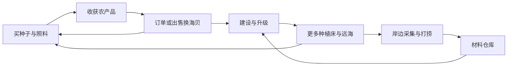

# sea · 第一版经营循环

版本：2026-10-22，已接入 Godot。本文区分实际规则与后续扩展。

## 玩家循环

**种植／采集 → 收获进背包 → 交订单或出售农产品 → 材料入库 → 建设与升级 → 更多种植空间、远海探索 → 再投入。**

作物提供稳定收入，岸边采集和打捞提供建设材料。玩家自行决定休息推进作物生长；缺水只暂停生长。订单长期有效、免费换单，不要求每日上线。

## 物品去向与安全规则

| 类型 | 来源 | 用途 |
|---|---|---|
| 生菜、番茄、南瓜产物 | 种植收获 | 订单、出售、购买下一轮种子 |
| 鱼、贝壳等 | 现有采集玩法 | 对应订单 |
| 木料、缆绳 | sea采集点 | 仓库存料、建设、船升级 |
| 零件、玻璃 | 横滨铁道采集点 | 建设、温室、船升级 |
| 木料、零件 | 可重复打捞 | 不依赖种子和海贝的基础材料补给 |

仓库只收物品表中 category=material 的物品。种子、作物、货币留在背包。订单只从背包扣货，仓库材料不会被自动交单或出售；要交材料订单，可先取回背包。现有“出售农产品”仍出售背包中全部农产品，界面明确提醒包含订单用料。

建设统一先检查背包＋仓库合计数量，足够才支付；先扣背包，再扣仓库，不足不扣款。订单先模拟扣货后的容量，再检查额外奖励是否全部放得下，失败不扣货、不消耗订单。成功订单不可重复领取。

## 推荐进度与实际门槛

推荐顺序是引导，不是强制任务链；材料齐全可自行选择优先建设。

| 阶段 | 成本或门槛 | 实际收益 |
|---|---|---|
| 起步 | 木屋 Lv.1；赠送 80 海贝、3 包生菜种子 | 家门口 6 格种植床 |
| 材料仓库 | 12 海贝、4 木料 | 48 格独立仓库、一键存材料、按物品取回 |
| 圆弧农场 Lv.2 | 25 海贝、5 木料、3 零件；施工 20 秒 | 开放第二块 6 格种植床，总计 12 格 |
| 木屋 Lv.2 | 20 海贝、4 木料、2 零件；施工 18 秒 | 温室和回收台的建筑前置 |
| 小船 Lv.2 | 25 海贝、6 木料、4 零件、2 缆绳 | 开放远海区域及平台 6 格种植床，总计 18 格 |
| 温室 | 木屋 Lv.2、农场 Lv.1；15 海贝、5 木料、3 零件、2 玻璃 | 新种作物首茬少长 1 天，每茬多收 1 份 |
| 回收台 | 木屋 Lv.2、车站 Lv.1；15 海贝、4 木料、4 零件 | 沿用现有主动收取零件功能 |
| 小船 Lv.3 | 60 海贝、10 木料、8 零件、4 缆绳 | 巡航速度提高 15%，保留转弯减速和靠泊制动 |

平台区域本身仍可到达，限制的是空地格播种；远海沿用 zone4 的区域解锁规则。旧档已经种下的作物允许继续照料、收获；收完清空后才应用新门槛，避免旧作物被锁死。

## 点击操作和反馈

1. 点击顶部“建造”，查看“小目标”、已有／需要数量和材料来源。
2. 点击“设为小目标”切换追踪；当前目标完成后自动推荐下一个未完成目标。追踪选择会存档。
3. 点击建筑“前往”，到建造牌交付；施工结束才增加等级。设施和船升级沿用建设页按钮。
4. 建好仓库后，岸上打开“背包”，点击“材料一键入库”。取回按单种物品进行，尽量取满背包可用空间，余量留在仓库。
5. 点击码头订单板前往打开，交单立即到账；9 秒后补位。随时可免费换一批，不扣海贝。

仓满时未存入部分留在背包；包满时取回不会丢库存；完成或阻止操作都显示原因。仓库本版是菜单服务，没有新增独立仓库建筑模型。界面沿用奶油底色、圆角卡片与既有动态反馈。

## 实现职责与存档

- `scripts/economy.gd`：独立仓库 Inventory、联合建设支付、船成本、目标追踪、存档。
- `scripts/core/orders.gd`：不再递减订单期限；奖励容量检查；免费换单。旧存档的 left 字段为兼容保留，不参与过期判断。
- `scripts/core/farm.gd` 与 zone3 场景：第二床建筑门槛、第三床船等级门槛及旧作物保护。
- `scripts/core/build_site.gd`：世界建造牌使用同一套联合支付检查。
- `scripts/hud.gd`、`scripts/ui/order_panel.gd`：仓库入口、目标与进度、长期订单展示。
- `scripts/boat.gd`：三级船巡航系数。

Economy 存档新增 warehouse（capacity/counts）与 tracked_goal；旧档缺字段时建立空的 48 格仓库，不改变已有背包、建筑和作物。沿用现有 SaveGame 自动／手动存读档入口。

## 验证与边界

逻辑闭环测试 `tests/test_management_loop.gd` 覆盖种植交单、可重复打捞建仓、存取守恒、联合支付、施工开放地格、船与区域解锁、满级保护、容量拒绝和新旧存档。

回归命令：`bash godot/verify_click_controls.sh`。新增验收：`bash godot/verify_management.sh`；加 `--visual` 可在正常渲染器执行鼠标入库与换单并保存三张截图。测试使用内存状态，不写玩家存档。

本版尚未加入加工、料理、品质、季节、装饰收集奖励、仓库实体建造表现或长期经济平衡模拟。当前数值用于首个可玩循环，长期节奏仍需真人试玩迭代。

本次验收结果：经营逻辑 36 项、既有种植／地面／自检／核心／点击回归 1,395 项，共 1,431 项通过；Metal Forward+ 实际渲染下 2 项鼠标操作通过，无非预期错误。截图：`outputs/management-build.png`、`outputs/management-warehouse.png`、`outputs/management-orders.png`。连续入库触发的旧控件延迟样式错误已修复。
